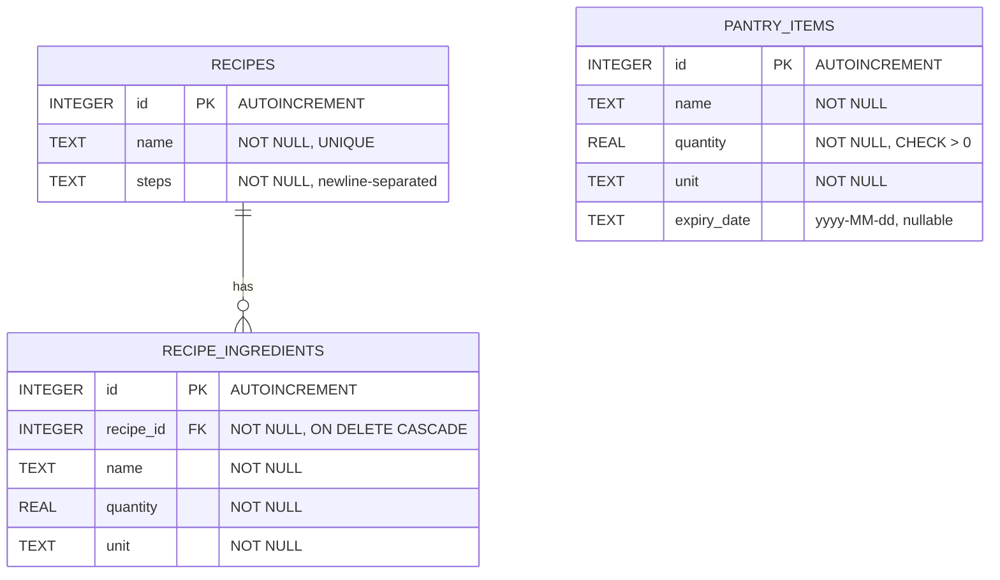

# Entity-relationship diagram

Database `smart_pantry.db`, version 1. `pantry_items` is independent of the recipe tables because pantry and recipe ingredients are linked by **normalised name** at matching time, not by a foreign key.

