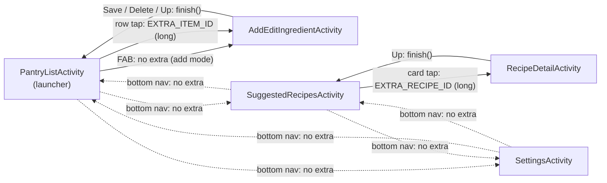

# Screen flow

Solid arrows are explicit Intents. Dotted arrows are bottom-navigation tab switches, which start the target Activity with `FLAG_ACTIVITY_REORDER_TO_FRONT`. The label on each arrow names the Intent extra it carries.

